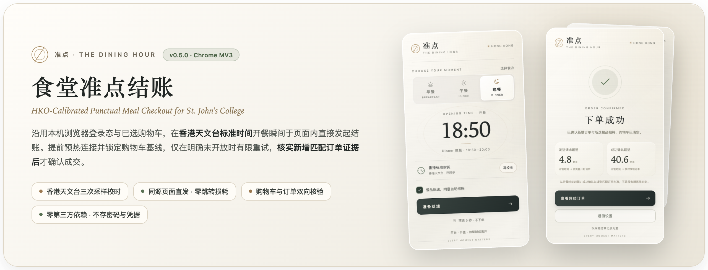
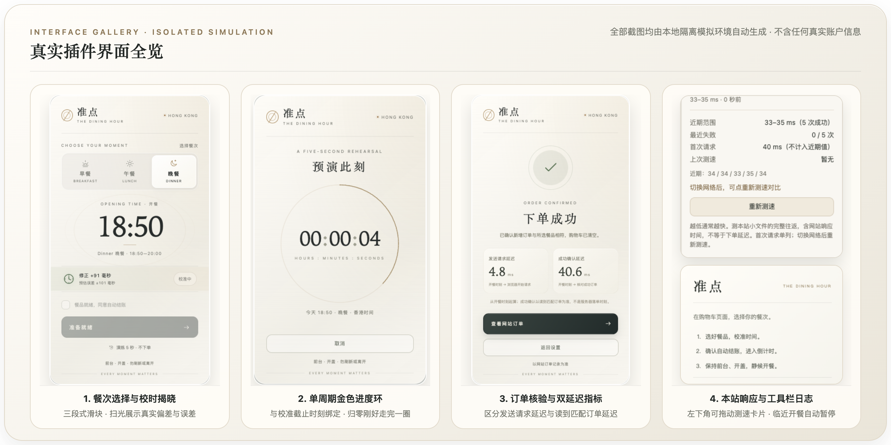
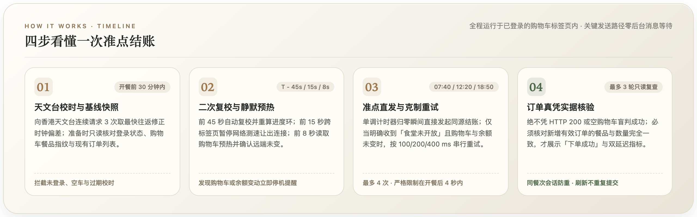

<div align="center">



<br />

[-0F172A?style=for-the-badge&logo=googlechrome&logoColor=white)](#quickstart)
[](#quickstart)
[](#how-it-works)
[](#project-structure)
[](#safety-and-limits)
[](LICENSE)

<p align="center">
  <b>简体中文</b> · <a href="README_EN.md">English</a>
</p>

<p align="center">
  <a href="#overview">✨ 一句话看懂</a> ·
  <a href="#features">🌟 核心亮点</a> ·
  <a href="#gallery">🖼️ 界面实拍</a> ·
  <a href="#quickstart">🚀 3 分钟上手</a> ·
  <a href="#how-it-works">⏱️ 运行原理</a> ·
  <a href="#safety-and-limits">🛡️ 安全与边界</a> ·
  <a href="#verification">🧪 隔离测试</a>
</p>

</div>

---

<a id="overview"></a>

## ✨ 一句话看懂它在做什么

在香港大学圣约翰学院（St. John's College）日常订餐时，热门餐品往往在开餐后的几秒内售罄。手动卡点点击不仅受限于**电脑系统时钟的几十至几百毫秒偏差**，还会因为整页刷新、静态资源加载或不清楚是否已经落单而错失良机，甚至因焦虑误点造成重复提交。

**准点 · 食堂准点结账（The Dining Hour）** 是一款专为食堂购物车页面打造的零依赖浏览器扩展：

> 你只需像平时一样登录食堂网站、把想吃的餐品放进购物车，插件就会自动对齐**香港天文台标准时间**，在早、午、晚餐开餐瞬间直接在当前页面发出结账请求；提前检查连接与购物车基线，仅在网站明确返回「尚未开放」时克制重试，并**逐项核实新增订单与餐品数量完全匹配后**，才向你确认下单成功。

---

<a id="features"></a>

## 🌟 为什么它既快又稳？

<table>
  <tr>
    <td width="33%" valign="top">
      <h3>🕰️ 香港天文台毫秒级校时</h3>
      <p>直接向香港天文台时钟服务连续采样 3 次，自动剔除缓存或慢响应，选取往返最快的一组修正本机时钟偏差；若提前较久准备，还会在<b>开餐前 45 秒自动复校</b>并平滑同步倒计时进度环。</p>
    </td>
    <td width="33%" valign="top">
      <h3>⚡ 页面内直发 · 零跳转损耗</h3>
      <p>沿用当前已登录页面的会话直接发送同源结账请求，无需模拟鼠标找按钮，也不必等待整页重载或扩展后台消息中转；开餐前 8 秒自动完成只读连接预热与购物车复查。</p>
    </td>
    <td width="33%" valign="top">
      <h3>🔁 克制且有据的未开放重试</h3>
      <p>绝不盲目并发刷接口。仅当页面明确提示 <code>The Dining Hall is closed</code> 且购物车餐品、账户余额与准备时分毫不差时，才在开餐后 4 秒窗口内按 <code>100 / 200 / 400 ms</code> 串行重试最多 4 次。</p>
    </td>
  </tr>
  <tr>
    <td width="33%" valign="top">
      <h3>🧾 拒绝假成功的证据级核验</h3>
      <p>收到 HTTP 200 或购物车变空都不直接算成功——插件会自动读取订单页（最多 3 轮只读复查），核实<b>新增有效订单的餐品名称、单价、数量与准备时完全一致</b>才宣告成交。</p>
    </td>
    <td width="33%" valign="top">
      <h3>📡 智能避让的本站响应测速</h3>
      <p>左下角自带可拖动的独立测速小卡片，绕过缓存测量本站真实往返中位数，方便对比校园网与手机热点快慢；<b>临近开餐前 15 秒跨标签页自动暂停</b>，绝不抢占下单通道。</p>
    </td>
    <td width="33%" valign="top">
      <h3>🎨 温润纸感界面与无损演练</h3>
      <p>采用暖白磨砂纸感、细金刻度与衬线数字设计，整体 90% 精致缩放并完整支持键盘导航与「减少动态效果」。内置<b>「演练 5 秒 · 不下单」</b>模式，零网络请求即可随时熟悉全流程。</p>
    </td>
  </tr>
</table>

---

<a id="gallery"></a>

## 🖼️ 真实界面全景实拍

<p align="center">
  
</p>

### 双延迟指标读数说明

每次尝试结束后，结果页都会以校准后的香港开餐时刻为起点，如实冻结并展示两项关键耗时（演练、失败或结果未确认时，确认延迟一律显示 `—`，绝不用 `0 ms` 或假数据充数）：

| 指标名称 | 计时起点 → 终点 | 真实含义与边界 |
| --- | --- | --- |
| **发送请求延迟** | 校准后的开餐时刻 → 浏览器首次调用结账请求 | 衡量本机定时器与页面触发精度；它不是请求抵达食堂服务器的时刻，也不含网络传输耗时。 |
| **成功确认延迟** | 校准后的开餐时刻 → 完整读回订单页并核实匹配的新增订单 | 包含网络等待、必要的未开放重试与订单列表只读核对耗时；由于网站不公开服务器内部落单毫秒时间戳，它代表本机拿到确凿成交证据的时刻。 |

---

<a id="quickstart"></a>

## 🚀 3 分钟安装与日常使用

### 第一步：安装或更新扩展

1. **获取扩展文件**
   - **方式 A（推荐，直接下载成品包）**：前往本仓库 [Releases 页面](https://github.com/MagicalNobodee/The-Dining-Hour/releases/latest) 下载最新的 `The-Dining-Hour-v0.5.0.zip` 并解压。
   - **方式 B（克隆源码仓库）**：
     ```bash
     git clone https://github.com/MagicalNobodee/The-Dining-Hour.git
     ```
2. **加载到浏览器**
   - 在 Chrome / Edge / Arc 地址栏打开 `chrome://extensions`，开启右上角的 **「开发者模式」**。
   - 点击左上角 **「加载已解压的扩展程序」**，选择项目中的 **`extension`** 文件夹即可。
   - 若日后更新版本，只需在扩展管理页找到「食堂准点结账」点击**重新加载**，并刷新一次购物车网页。

### 第二步：每次抢饭五步曲

1. **加好餐品**：手动登录食堂网站（`https://dh.stjohns.hk/cart/`），将本餐次想吃的餐品加入购物车，停留在购物车页面。
2. **选择餐次**：在右下角「准点」浮窗顶部切换早、午、晚餐（按住标题栏可自由拖动位置，支持键盘左右方向键）：

   | 餐次 | 食堂供应时段（香港时间） | 插件自动触发时刻 |
   | --- | --- | --- |
   | **早餐 Breakfast** | `07:40 – 09:30` | **`07:40:00`** |
   | **午餐 Lunch** | `12:20 – 13:45` | **`12:20:00`** |
   | **晚餐 Dinner** | `18:50 – 20:00` | **`18:50:00`** |

3. **校准时间**：在**所选餐次开餐前 30 分钟内**点击「校准」，等待约 3.6 秒扫光揭晓本次时钟修正量与估计误差，状态变为 `香港天文台 · 已同步`。
4. **准备就绪**：勾选「餐品就绪，同意自动结账」，点击 **「准备就绪」**。插件会自动核对登录状态、当前购物车与已有订单，随后切入金色进度环倒计时。
5. **静候开餐**：保持**电脑开盖、当前购物车标签页处于前台可见**（不要刷新、不要切到后台标签页）。倒计时归零后会自动提交并核对订单，结果直接呈现在面板上，点击「查看网站订单」即可复核。

> 💡 **新手初体验建议**：装好后无需等到饭点，直接点击面板底部的 **「演练 5 秒 · 不下单」**，即可完整体验倒计时进度环、提交动效与结果页过渡——演练过程**零网站请求、绝不触碰购物车或下单**。

---

<a id="how-it-works"></a>

## ⏱️ 四步看懂准点结账机制

<p align="center">
  
</p>

| 保护机制 | 具体行为说明 |
| --- | --- |
| **单调时钟防漂移** | 倒计时采用浏览器单调递增计时器（`performance.now()`）与系统时间双向比对；若等待期间电脑曾合盖休眠、系统时间异常跳变、页面切入后台或迟到超过 `1 秒`，尚未发出的任务会立即安全终止，绝不盲目补单。 |
| **跨标签页单任务互斥** | 同一时间只允许一个食堂标签页进入准备状态；同一餐次一旦发出过结账请求，当前浏览器会话内都会保留防重标记，即使手动刷新页面也不会再次自动提交。 |
| **异常结果立即刹车** | 登录过期、余额不足、餐品售罄、服务器报错、网络中断、部分成交、数量多于预期或页面结构变化时，插件都会**立即停止追加请求**，并明确提示「订单需核对／结果待核对」。 |
| **发后取消不撤单提醒** | 请求发出前点击「取消」可彻底撤回任务；一旦首个请求已经发出，按钮会自动变为「停止后续尝试」——只停止后续重试，仍会为你读完并核对已发出请求的真实结果。 |

---

<a id="safety-and-limits"></a>

## 🛡️ 隐私承诺与已知边界

- **零敏感信息存储**：扩展运行全程零第三方依赖、不加载任何远程字体或外部脚本。本地存储仅保留面板坐标、测速摘要与最近 20 条简短状态时间记录；**绝不保存账号密码、Cookie、账户余额或历史餐品清单**。购物车与订单快照仅在当次任务内存中比对。
- **浏览器底层重发说明**：食堂网站采用 `GET /ordered/` 地址执行结账。本地隔离断连测试表明，当网络连接意外中断时，Chromium 内核可能在底层自动重发一次 GET 请求（即便扩展代码只调用过一次）。这是非幂等网站架构下的浏览器传输层行为，因此**在结果尚不明确时，切勿自行另开标签页重复点击结账**。
- **网络路线与抢购概率**：左下角「本站响应」包含网站处理时间，适合用来比较不同网络（如校园 Wi-Fi 与手机热点，或开启与关闭系统代理）访问本站的相对快慢，但插件不会接管或修改你的系统代理设置。热门餐品最终能否成交仍取决于实时网络抖动、服务器排队与库存竞争，任何工具都无法承诺 100% 抢到。

---

<a id="project-structure"></a>
<a id="verification"></a>

## 🗂️ 项目结构与本地隔离测试

```text
The-Dining-Hour/
├── extension/               # Chrome / Edge Manifest V3 扩展源码（零第三方依赖，直接加载此目录）
│   ├── manifest.json        # 扩展配置与最小权限声明（storage、power、天文台校时域名）
│   ├── core.js              # 香港三餐时间计算、天文台 clock9a 解码、校时与重试时间窗校验
│   ├── site.js              # 食堂购物车、余额指纹、关闭提示与新增订单双向比对解析
│   ├── view.js              # Shadow DOM 隔离样式、暖白纸感面板与四阶段动效模板
│   ├── network.js           # 左下角独立本站响应测速卡片与下单窗口自动避让逻辑
│   ├── content.js           # 准备检查、单调倒计时、预热复校、串行结账与结果核验主控
│   ├── background.js        # 天文台采样、跨标签页租约互斥、屏幕常亮与最近 20 条记录
│   └── popup.html / .js     # 浏览器工具栏弹窗与最近运行日志查看器
├── tests/                   # 100% 本地隔离模拟测试套件（绝不连接真实食堂服务器或真实下单）
│   ├── check.cjs            # 结账全链路回归测试（本地 HTTPS 模拟服 + 专用拦截代理，覆盖 20+ 边界场景）
│   ├── design.cjs           # 界面缩放、拖拽、键盘无障碍、校时揭晓、进度环与减少动态效果测试
│   ├── network.cjs          # 测速中位数、缓存剔除、错误识别、倒计时 15 秒静默避让测试
│   └── runtime.cjs          # 跨环境 Playwright 与 Chromium 自动探测辅助模块
├── scripts/
│   ├── pack.cjs             # 一键生成干净的扩展分发压缩包（输出至 dist/）
│   └── render-docs.cjs      # 基于本地模拟截图自动合成高清 README 导览插图
└── docs/assets/             # README 高清导览图与隔离环境界面实拍
```

### 运行自动化验证

测试套件通过临时自签名证书与本地专用代理完整模拟食堂网站，**拒绝访问一切外部食堂主机，绝不会发出任何真实结账请求**：

```bash
# 安装开发测试依赖（插件日常使用无需安装任何依赖）
npm install

# 一键运行全部三组隔离回归测试（结账状态机 + 界面交互 + 本站响应测速）
npm test

# 打包生成可分发的扩展 ZIP（输出至 dist/The-Dining-Hour-v0.5.0.zip）
npm run pack
```

---

## 📄 开源协议

本项目基于 [MIT License](LICENSE) 开源，仅供校园日常订餐便利与前端定时可靠性学习交流使用。
