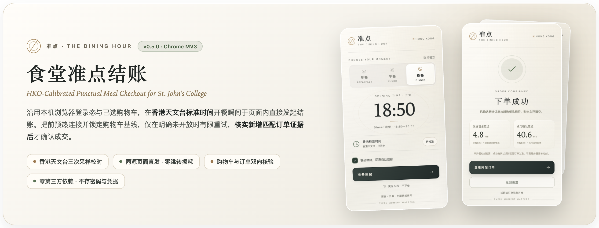
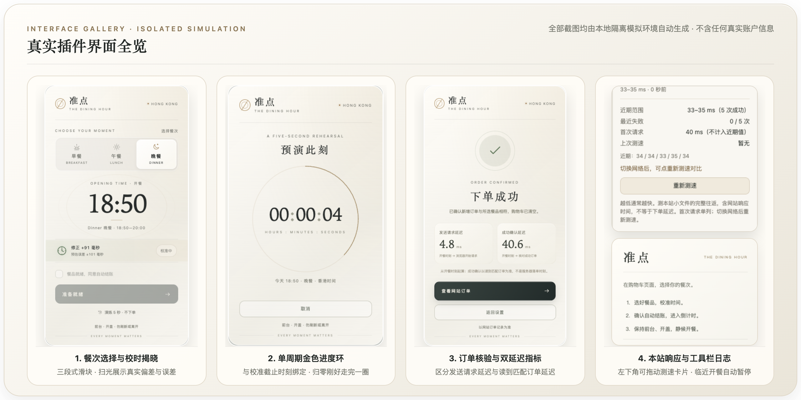
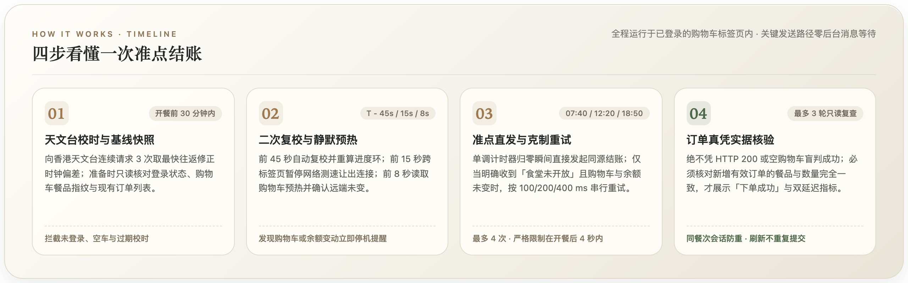

<div align="center">



<br />

[-0F172A?style=for-the-badge&logo=googlechrome&logoColor=white)](#quickstart)
[](#quickstart)
[](#how-it-works)
[](#project-structure)
[](#safety-and-limits)
[](LICENSE)

<p align="center">
  <a href="README.md">简体中文</a> · <b>English</b>
</p>

<p align="center">
  <a href="#overview">✨ Overview</a> ·
  <a href="#features">🌟 Highlights</a> ·
  <a href="#gallery">🖼️ Interface</a> ·
  <a href="#quickstart">🚀 Quickstart</a> ·
  <a href="#how-it-works">⏱️ How It Works</a> ·
  <a href="#safety-and-limits">🛡️ Safety & Limits</a> ·
  <a href="#verification">🧪 Isolated Tests</a>
</p>

</div>

---

<a id="overview"></a>

## ✨ What Is The Dining Hour?

When ordering meals at **St. John's College (HKU)**, popular dishes often sell out within seconds of opening. Clicking manually at the opening second suffers from **local system clock drift**, full-page reload overhead, and uncertainty over whether an order actually went through.

**The Dining Hour (准点 · 食堂准点结账)** is a lightweight, zero-dependency Manifest V3 browser extension built specifically for the Dining Hall cart page:

> Simply sign in as usual and add your dish to the cart. The extension calibrates against **Hong Kong Observatory Standard Time**, sends a same-origin checkout request directly from your open cart tab at the exact meal-opening second, retries conservatively *only* if the server explicitly reports `The Dining Hall is closed` with an unchanged cart and balance, and **verifies matching new order rows before confirming success**.

---

<a id="features"></a>

## 🌟 Key Highlights

- **🕰️ Hong Kong Observatory Calibration**: Samples HKO's official clock endpoint three times, discards cached or high-RTT responses, and applies the fastest round-trip offset. Automatically re-calibrates **45 seconds before opening** on longer waits.
- **⚡ Zero-Navigation In-Page Checkout**: Sends the same-origin checkout request directly inside your authenticated `/cart/` tab with zero background IPC overhead on the critical send path, plus a read-only pre-warm check **8 seconds before opening**.
- **🔁 Strictly Bounded Closed-Hours Retry**: Never floods the server. Retries serially (`100 / 200 / 400 ms`, up to 4 total attempts within 4 seconds of opening) *only* when the response explicitly states `The Dining Hall is closed` and both cart items and balance match your pre-flight baseline.
- **🧾 Evidence-Based Order Verification**: Never trusts HTTP 200 or an empty cart alone. Reads `/order_details/` (up to 3 read-only checks within 12s) to verify that new order rows match your exact dishes and quantities.
- **📡 Smart Same-Origin Latency Indicator**: A draggable bottom-left probe card measures non-cached site response medians so you can compare Wi-Fi vs. mobile hotspot, while **automatically pausing across all tabs 15 seconds before checkout**.
- **🎨 Editorial Ivory UI & Safe 5-Second Rehearsal**: Warm matte-paper design at 90% scale with keyboard navigation, `prefers-reduced-motion` support, and a **zero-network 5-second rehearsal mode**.

---

<a id="gallery"></a>

## 🖼️ Interface Showcase

<p align="center">
  
</p>

---

<a id="quickstart"></a>

## 🚀 3-Minute Quickstart

### 1. Install the Extension

1. Download `The-Dining-Hour-v0.5.0.zip` from [GitHub Releases](https://github.com/MagicalNobodee/The-Dining-Hour/releases/latest) and unzip it (or `git clone https://github.com/MagicalNobodee/The-Dining-Hour.git`).
2. Open `chrome://extensions` in Chrome / Edge / Arc and enable **Developer mode** in the top-right corner.
3. Click **Load unpacked** and select the **`extension`** folder.

### 2. Daily Meal Checkout

1. Log in and add your meal to `https://dh.stjohns.hk/cart/`.
2. Pick your meal slot in the floating panel:

   | Meal | Service Hours (HKT) | Auto-Trigger Time |
   | --- | --- | --- |
   | **Breakfast** | `07:40 – 09:30` | **`07:40:00`** |
   | **Lunch** | `12:20 – 13:45` | **`12:20:00`** |
   | **Dinner** | `18:50 – 20:00` | **`18:50:00`** |

3. Within **30 minutes before opening**, click **校准 (Calibrate)** until it shows `香港天文台 · 已同步`.
4. Check the confirmation box and click **准备就绪 (Arm)**.
5. Keep your laptop lid open and the `/cart/` tab in the foreground. When the golden countdown ring finishes, the extension submits and verifies your order automatically.

---

<a id="how-it-works"></a>

## ⏱️ How It Works

<p align="center">
  
</p>

---

<a id="safety-and-limits"></a>

## 🛡️ Privacy & Known Limits

- **Local-Only Privacy**: Zero external libraries, remote fonts, or analytics. Only panel coordinates, speed summaries, and the latest 20 short status timestamps are kept in `chrome.storage.local`—**never passwords, cookies, balances, or dish histories**.
- **Non-Idempotent Site Checkout**: Because the dining site executes checkout via `GET /ordered/`, Chromium may automatically retry a dropped connection once at the transport layer. Never manually click checkout in a second tab while an attempt is still being verified.
- **No Guaranteed Stock**: Network routing, server queuing, and dish inventory contention remain outside client control.

---

<a id="project-structure"></a>
<a id="verification"></a>

## 🧪 Isolated Verification Suite

All tests run against a local ephemeral HTTPS mock server and dedicated proxy—**zero requests ever touch the real dining hall server**:

```bash
npm install
npm test
npm run pack
```

---

## 📄 License

Released under the [MIT License](LICENSE).
